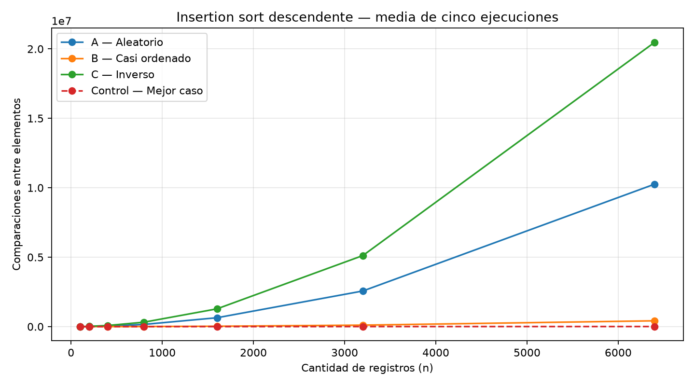
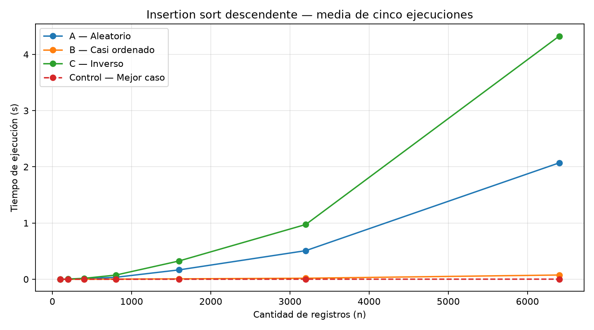
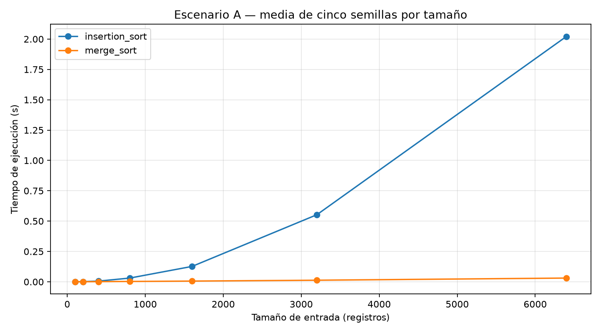

# Laboratorio 1 — Tamiza

**Autor:** Samuel Andrés García Sierra

## Instrucciones para reproducir el experimento

Desde esta carpeta, se requiere Python 3.10 o posterior. Los algoritmos están
en [algoritmos.py](algoritmos.py) y los generadores en [datos.py](datos.py).

Crear el entorno virtual (solo la primera vez):

```bash
python -m venv .venv
```

Activarlo en Windows PowerShell:

```powershell
.\.venv\Scripts\Activate.ps1
```

Alternativa en Windows CMD: `.venv\Scripts\activate.bat`.
En Linux/macOS: `source .venv/bin/activate`.

Instalar Matplotlib y ejecutar las pruebas y cada parte práctica:

```bash
python -m pip install matplotlib
python -m unittest discover -v
python parte3_casos.py
python parte4_complejidad.py
```

Las Partes 1 y 2 son argumentativas y no requieren ejecutar comandos.
Los experimentos guardan los CSV en `resultados/` y las tres imágenes en
`graficas/`. No ejecutan el lote real de 1.200.000 registros. Para salir del
entorno virtual: `deactivate`.

**Alcance del informe:** los resultados corresponden a datos sintéticos y
mediciones locales. Las extrapolaciones no certifican el funcionamiento en
producción; el ejemplo municipal y la potencia de 300 W son supuestos
ilustrativos, no datos medidos.

## Parte 1 — Analizar el algoritmo antes de comprar hardware

Un algoritmo es **correcto** cuando produce la salida especificada para toda
entrada válida. En Tamiza, esto significa ordenar los pacientes de mayor a
menor índice de riesgo. La **eficiencia**, en cambio, describe los recursos
que necesita para hacerlo. Por eso, el algoritmo actual puede ordenar bien
y aun así incumplir la restricción operativa: procesar **1.200.000 registros
en cuatro horas (14.400 s)**. La corrección responde si el resultado es el
adecuado; la eficiencia permite evaluar si llega a tiempo y con qué costo.
Una lista correcta que llega tarde pierde utilidad para el equipo encargado
de realizar las llamadas.

Duplicar la velocidad del servidor solo reduce el tiempo por un factor
constante. Si el algoritmo es cuadrático, `T(n) ≈ c·n²`, un equipo idealmente
el doble de rápido daría `T(n) ≈ (c/2)·n²`: el crecimiento sigue siendo
cuadrático. En mis mediciones, insertion sort tardó aproximadamente 2,02 s
con 6.400 elementos. Al extrapolar a 1.200.000, obtengo unas **19,7 h**; con
el doble de velocidad ideal serían **9,9 h**, todavía por encima del límite.
Además, bastaría un aumento del volumen cercano al 41 % (`√2 ≈ 1,41`) para
volver al tiempo anterior a la compra.

En contraste, al extrapolar merge sort según su crecimiento `n log n`,
obtengo unos **9,2 s** para el mismo lote. Son estimaciones basadas en datos
sintéticos de mi equipo, no mediciones del servidor de Tamiza. Sin embargo,
muestran por qué conviene analizar primero el algoritmo: cambiar su orden
de crecimiento puede aportar mucho más que acelerar el hardware.

**Ejemplo propio: una central municipal de emergencias.** Supongo una
central que recibe **200.000 reportes nocturnos** y dispone de **30 minutos
(1.800 s)** para ordenarlos por severidad antes del cambio de turno de las
6:00. Es un escenario hipotético. Usando las mediciones del laboratorio
como referencia:

- Insertion sort: `2,021465 s · (200.000 / 6.400)² ≈ 1.974 s`, unos
  **33 minutos**: no cumple el plazo.
- Merge sort: `0,030733 s · (200.000·log₂200.000)/(6.400·log₂6.400)
  ≈ 1,3 s`: cumple con amplio margen bajo el modelo.

Ambos algoritmos producen una lista correcta, pero solo uno satisface la
restricción estimada con el equipo original. Un servidor el doble de rápido
reduciría insertion sort a unos 16 minutos; aun así, con aproximadamente
283.000 reportes volvería a superar el plazo. Mi conclusión es que la compra
de hardware debe justificarse después de evaluar el algoritmo, no utilizarse
como sustituto de ese análisis.

## Parte 2 — Responsabilidad ambiental y ética de la implementación

El consumo energético de un proceso puede aproximarse mediante `E = P · t`,
donde P es la potencia media y t el tiempo de ejecución. El tiempo de cómputo
no representa solo una espera: también implica consumo de energía. Como
Tamiza ejecuta el proceso **todos los días**, una ineficiencia repetida
acumula costos económicos y ambientales.

Para ilustrarlo, supongo una potencia media de **300 W durante el
ordenamiento**. Este valor no fue medido y no representa necesariamente al
servidor real. Aplicándolo a los tiempos extrapolados del escenario A:

| Algoritmo | Tiempo estimado por lote | Energía por lote | Energía de 365 lotes |
|---|---:|---:|---:|
| insertion_sort | ≈ 19,74 h | ≈ 5,92 kWh | ≈ 2.162 kWh |
| merge_sort | ≈ 9,2 s | ≈ 0,00077 kWh | ≈ 0,28 kWh |

La comparación supone la misma potencia media para ambos algoritmos y no
incluye refrigeración ni consumo en reposo. No es una medición del ahorro
real, pero permite apreciar el efecto acumulado del tiempo de ejecución.
Comprar un equipo más rápido tampoco garantiza una reducción proporcional
de energía: habría que medir su potencia y considerar la fabricación y el
destino del equipo reemplazado. Mejorar el algoritmo puede reducir el trabajo
sin exigir una renovación de hardware.

**Identifico dos perjuicios concretos:**

1. **Retraso en la atención de pacientes de alto riesgo.** Si el proceso
   supera las cuatro horas, las llamadas pueden comenzar tarde o basarse en
   una lista desactualizada. El costo recae sobre los **pacientes y sus
   familias**, que no participaron en la decisión técnica. En un contexto
   sanitario, esa demora puede contribuir a complicaciones evitables.
2. **Gasto económico e impacto ambiental del cómputo innecesario.** La
   electricidad, la refrigeración y las horas de servidor las paga la
   **institución**, con recursos que podrían destinarse a atención o
   personal. Las emisiones asociadas al consumo energético afectan a la
   **sociedad**, aunque su magnitud depende de la fuente de electricidad.

**Ordenar la lista también implica responsabilidad sobre la priorización.**
En Tamiza, el orden determina a quién se llama primero. Por eso, considero
que quien implementa el sistema debe atender cuatro obligaciones:

- **Verificar la corrección.** Un error puede ubicar a un paciente de alto
  riesgo detrás de otro de menor riesgo. Las pruebas deben comprobar el
  orden resultante, no solo la velocidad.
- **Evaluar el peor caso.** Cumplir el plazo en promedio no basta cuando un
  lote desfavorable puede retrasar la atención. El análisis debe acompañarse
  de pruebas integrales y márgenes operativos.
- **Definir los empates con el equipo clínico.** Merge sort conserva el
  orden previo de los índices iguales, pero la estabilidad no equivale a
  una política clínica. Criterios como la antigüedad del registro o las
  comorbilidades no deberían decidirse de manera implícita en el código.
- **Facilitar la trazabilidad.** Debe ser posible explicar y auditar cómo
  se construyó la lista y qué criterios determinaron cada prioridad.

En conclusión, la responsabilidad de desarrollo no termina en obtener una
lista ordenada: también incluye evaluar su oportunidad, su costo y las
consecuencias de la priorización sobre las personas.

## Parte 3 — Peor caso, mejor caso y caso promedio

[Código de la Parte 3](parte3_casos.py).
Se utilizan los algoritmos de [algoritmos.py](algoritmos.py) y los generadores
de [datos.py](datos.py).

### Decisión sobre los datos

Se utilizan enteros distintos de 1 a n, como valores sintéticos experimentales.
El rango clínico 0–1000 no permite 6400 valores distintos. Esta adaptación,
elegida para el laboratorio, permite conservar los siete tamaños sugeridos;
no representa literalmente la distribución de riesgos clínicos.

En B se toman floor(0,98 n) valores de una permutación y se construye su
prefijo descendente; los restantes se anexan en el orden aleatorio obtenido.
No se obliga al sufijo a contener una inversión: una muestra aleatoria puede
quedar ordenada por casualidad, especialmente si contiene cero o un elemento.

### 3.1 — Definición de los casos y criterio de decisión

Para un tamaño n fijo, considero **todas las permutaciones de n índices
distintos**. Sobre ese conjunto defino el costo de cada entrada como la
cantidad de comparaciones entre elementos. El tiempo también puede
analizarse, aunque depende del equipo y de sus condiciones de ejecución.

- **Peor caso:** es el máximo costo entre todas las entradas de tamaño n.
  En insertion sort descendente ocurre cuando la lista llega en orden
  ascendente, como en C: cada elemento recorre todo el prefijo y se realizan
  `n(n−1)/2` comparaciones.
- **Mejor caso:** es el mínimo sobre el mismo conjunto. Para n ≥ 1, una
  lista ya ordenada en forma descendente requiere `n−1` comparaciones.
- **Caso promedio:** es el valor esperado del costo bajo una distribución
  de probabilidades. Supongo que las `n!` permutaciones son igualmente
  probables. Con esa distribución uniforme, el número esperado de
  desplazamientos es `n(n−1)/4`; las comparaciones incluyen además las
  comparaciones falsas que detienen las búsquedas.

**Para decidir el paso a producción usaría el peor caso.** La ventana de
cuatro horas es estricta: cumplirla en promedio no evita el retraso cuando
llega un lote desfavorable. Además, el promedio depende de que la
distribución supuesta represente los datos reales, algo que aquí no está
garantizado. Complementaría el análisis asintótico con una prueba integral
en el servidor de producción: un lote representativo de tamaño real,
lectura de datos, ordenamiento y generación de la lista, midiendo tiempo y
memoria y considerando la carga concurrente.

### Predicción previa al experimento

Antes de ejecutar las mediciones, y a partir del funcionamiento de
insertion sort descendente, esperaba lo siguiente:

- **C será el peor escenario.** Si la lista llega en orden ascendente, cada
  nuevo elemento es mayor que todos los anteriores y debe recorrer el
  prefijo completo. Preveo exactamente `n(n−1)/2` comparaciones.
- **A se ubicará en un punto intermedio, cerca de la mitad de C.** En una
  permutación aleatoria, cada elemento debería recorrer en promedio la
  mitad del prefijo, por lo que espero alrededor de `n²/4` comparaciones y
  un crecimiento cuadrático. Al tomar solo cinco semillas, anticipo que la
  media se acercará a ese valor sin coincidir exactamente.
- **B será el más barato de los tres, pero no lineal.** El 98 % inicial ya
  está ordenado, por lo que esos elementos casi no generan trabajo. Sin
  embargo, el 2 % final debe insertarse dentro de un prefijo largo; como
  ese 2 % crece con n, también espero un crecimiento cuadrático, aunque con
  una constante mucho menor que la de A.
- **Ninguno de los tres será el mejor caso.** El mejor caso real es una
  lista ya ordenada de forma descendente, con `n−1` comparaciones. Por eso
  incluyo esa lista como control, para medir qué tan lejos queda B de él.
- **Respecto del tiempo,** espero que siga el mismo orden que las
  comparaciones (C > A > B > control) y que, al duplicar n, el tiempo de A
  y C se multiplique aproximadamente por cuatro.

### 3.2 — Método y evidencia

Se usan n = 100, 200, 400, 800, 1600, 3200 y 6400.
Para A y B se emplean cinco semillas: 42, 43, 44, 45 y 46.
C y el control descendente se ejecutan cinco veces también.
El CSV conserva cada tiempo y cada cuenta; las gráficas muestran las medias.

Los datos se generan antes del cronómetro. Se utiliza perf_counter únicamente
alrededor de insertion_sort, incluyendo su copia interna, como exige su contrato.
La validación del resultado se hace después del cronómetro.
Solo se cuentan comparaciones de valores, incluida la comparación falsa que
detiene una búsqueda; no se cuentan límites ni índices.





### Resultados observados

Resumen de las cinco ejecuciones para n = 6400 (tiempos de este equipo):

| Entrada | Comparaciones medias | Tiempo medio (s) |
|---|---:|---:|
| A — Aleatorio | 10.260.592,8 | 2,070479 |
| B — Casi ordenado | 419.473,6 | 0,074979 |
| C — Inverso | 20.476.800 | 4,326063 |
| Control — Mejor caso | 6.399 | 0,001485 |

Se verificaron 140 mediciones: siete tamaños, cuatro entradas y cinco
repeticiones. En todos los tamaños, C coincide con n(n−1)/2 y el control
con n−1. Se generaron y revisaron ambas gráficas. Estos datos son evidencia
experimental; su interpretación se desarrolla a continuación.

### 3.2 — Interpretación de los resultados

1. **Mayor y menor costo.** Con n = 6.400, C tuvo más comparaciones:
   20.476.800, exactamente `n(n−1)/2`, y un tiempo medio de 4,33 s. Es el
   peor caso de insertion sort descendente. B fue el menos costoso entre
   A, B y C, con 419.473,6 comparaciones medias y 0,075 s. Sin embargo, el
   verdadero mejor caso es el control descendente, con 6.399 comparaciones.
2. **Aproximación al promedio.** A muestrea el caso promedio bajo el supuesto
   de permutaciones uniformes. Sus 10.260.592,8 comparaciones medias están
   cerca del término dominante `n²/4 = 10.240.000`. La razón C/A es
   aproximadamente 2, coherente con los términos dominantes `n²/2` y `n²/4`.
   Esto no convierte cinco muestras en el promedio exacto.
3. **B no equivale al mejor caso.** Con n = 6.400, los 128 elementos del
   sufijo se insertan en un prefijo inicialmente ordenado de 6.272 elementos.
   Como aproximación, recorrer la mitad de ese prefijo por inserción supone
   `128 · 6.272 / 2 = 401.408` desplazamientos. Las inserciones también
   pueden recorrer elementos anteriores del sufijo y terminar con una
   comparación falsa. Así se explica la cercanía con el total medido y por
   qué B realiza unas 65,6 veces las comparaciones del control.
4. **Contraste con mi predicción.** Las mediciones confirmaron el orden
   que esperaba, `C > A > B > control`, en todos los tamaños. C coincidió
   exactamente con `n(n−1)/2` y A quedó cerca de `n²/4`, sin coincidir
   exactamente, como anticipé por usar solo cinco semillas. Al duplicar n,
   las comparaciones de A y C aumentaron aproximadamente por cuatro.
5. **Límites del experimento.** Los tamaños llegan hasta 6.400 y se usaron
   enteros en mi equipo, no registros de pacientes en producción. Los
   tiempos excluyen lectura y generación de la lista, y solo hay cinco
   repeticiones por tamaño y escenario. La evidencia permite comparar el
   comportamiento de los algoritmos, pero no certificar cuatro horas para
   1.200.000 registros.

Los tiempos dependen del equipo y de su carga; las semillas reproducen las
entradas y las comparaciones, no garantizan tiempos idénticos. Cinco muestras
no demuestran por sí solas un promedio exacto ni una cota de peor tiempo.

## Parte 4 — Complejidad de merge sort e insertion sort

[Código de la Parte 4](parte4_complejidad.py).
Las implementaciones están en [algoritmos.py](algoritmos.py) y los datos se
generan con [datos.py](datos.py).

Esta sección reúne el análisis de complejidad, la evidencia experimental y
mi recomendación técnica para el equipo de ingeniería.

### Ejecutar

```bash
python -m unittest discover -v
python parte4_complejidad.py
```

Se usan los mismos siete tamaños y cinco semillas de la Parte 3. Cada par de
algoritmos recibe la misma lista A, generada antes de cronometrar. Se alterna
el orden de ejecución. Se conservan comparaciones y tiempos individuales en
`resultados/parte4_mediciones.csv`. No se usan funciones de ordenamiento de
Python ni se mide la generación o la comprobación del resultado.

### 4.1 — Recurrencia de merge sort

Para n = 2^k y n > 1:

`T(n) = 2T(n/2) + Θ(n)`, con `T(1) = Θ(1)`.

Hay dos llamadas recursivas, cada una sobre la mitad de los datos. Combinar
recorre las dos mitades; las copias y los cortes de esta implementación
agregan trabajo lineal, sin cambiar ese término. No se cuentan esas copias
como comparaciones de elementos, pero sí forman parte del tiempo.

Árbol de recursión (c indica un costo lineal representativo):

```text
Nivel 0:                   n                         costo: c n
                          / \
Nivel 1:               n/2   n/2                      costo: 2 c(n/2) = c n
                      /  \   /  \
Nivel 2:            n/4 n/4 n/4 n/4                   costo: 4 c(n/4) = c n
                       ...
Nivel j:            2^j nodos de tamaño n/2^j         costo: c n
                       ...
Nivel k = log2(n):  n hojas de tamaño 1               costo: d n
```

Hay log2(n) niveles internos (0 hasta k−1) y un nivel de hojas:
log2(n)+1 niveles en total. Sumando los costos:

`T(n) = Σ[j=0..k−1] c n + d n = c n log2(n) + d n = Θ(n log n)`.

Si el costo por nodo está entre dos constantes positivas multiplicadas por
su tamaño, la misma suma da ambas cotas. Para tamaños no potencia de dos se
usan floor(n/2) y ceil(n/2); la altura es ceil(log2(n)) y la cota no cambia.
Esta versión siempre divide y mezcla, incluso si la entrada ya está ordenada.

### 4.1 — Conteo manual de insertion sort

Para n ≥ 1, definí m = n−1, s_i = desplazamientos al insertar el elemento i,
y S = Σ s_i. Sea F la cantidad de inserciones que terminan con una comparación
falsa de valores (no por llegar al límite izquierdo). Entonces C = S + F es
la cuenta que retorna el algoritmo, con 0 ≤ F ≤ m.

| Línea o instrucción de algoritmos.py | Ejecuciones / costo |
|---|---|
| `resultado = datos.copy()` | 1 ejecución, Θ(n) de trabajo |
| `comparaciones = 0` | 1 |
| `for i in range(1, len(resultado))` | m iteraciones, n controles del iterador |
| `actual = resultado[i]` | m |
| `j = i - 1` | m |
| `while j >= 0` | S + m evaluaciones de límite |
| `comparaciones += 1` | C |
| `if resultado[j] < actual` | C comparaciones de valores |
| `resultado[j + 1] = resultado[j]` | S |
| `j -= 1` | S |
| `else` | No agrega una comparación: es una rama |
| `break` | F |
| `resultado[j + 1] = actual` | m |
| `return resultado, comparaciones` | 1 |

Con costos constantes positivos por instrucción:

`T(n) = Θ(n) + a m + b(S+m) + c C + d S + e F + Θ(1) = Θ(n+S)`.

- Mejor: S=0, F=n−1, C=n−1; T(n)=Θ(n).
- Peor: s_i=i; S=1+2+...+(n−1)=n(n−1)/2; F=0;
  C=n(n−1)/2 y T(n)=Θ(n²).
- Promedio bajo permutaciones uniformes de valores distintos: cada pareja
  tiene probabilidad 1/2 de necesitar un desplazamiento. Por linealidad,
  E[S]=(1/2)·n(n−1)/2=n(n−1)/4; E[T(n)]=Θ(n²).

Para n=0 hay trabajo constante; no se aplica la expresión n−1 para C.

| Algoritmo implementado | Mejor | Peor | Promedio uniforme |
|---|---|---|---|
| insertion_sort | Θ(n) | Θ(n²) | Θ(n²) |
| merge_sort sin atajos | Θ(n log n) | Θ(n log n) | Θ(n log n) |

### 4.2 — Resultados medidos

Para n=6400, medias sobre las cinco semillas del escenario A:

| Algoritmo | Tiempo medido (s) | Estimación para 1.200.000 | Con doble velocidad ideal |
|---|---:|---:|---:|
| insertion_sort | 2,021465 | 71.067,13 s ≈ 19,74 h | ≈ 9,87 h |
| merge_sort | 0,030733 | 9,20 s | 4,60 s |

En este tamaño merge fue aproximadamente 65,8 veces más rápido. Las medias
medidas favorecieron a merge en los siete tamaños; no hubo cruce observado.
La curva de insertion crece mucho más pronunciadamente que la de merge.
Las fórmulas, supuestos y límites de estas estimaciones se explican abajo:
no son mediciones sobre el lote real ni una certificación de producción.

### 4.2 — Análisis de la gráfica



La curva de **insertion sort** crece cada vez más rápido: entre n = 3.200 y
n = 6.400, el tiempo pasó de aproximadamente 0,55 s a 2,02 s. El aumento de
unas 3,7 veces se acerca al factor 4 esperado para un crecimiento cuadrático.
En el mismo intervalo, **merge sort** pasó de unos 0,013 s a 0,031 s: un
factor cercano a 2,4, frente al factor aproximado de 2,2 del modelo `n log n`.
La escala compartida hace que su curva parezca casi pegada al eje horizontal,
pero su tiempo también crece.

Con n = 100, los tiempos son cercanos: aproximadamente 0,00034 s para
insertion sort y 0,00024 s para merge sort. Las llamadas recursivas, los
cortes y las asignaciones de merge sort pueden reducir su ventaja en
entradas pequeñas; estas mediciones no aíslan el costo de cada operación.
Merge fue más rápido en las medias de los siete tamaños: **no se observó
un cruce**.

Para Tamiza elijo **merge sort**. Con n = 6.400 fue unas 65,8 veces más
rápido, y la ventaja aumentó en los tamaños medidos. Esto es coherente con
4.1: insertion sort es Θ(n²) en promedio y en el peor caso, mientras que
esta implementación de merge sort es Θ(n log n) en todos los casos.

### Extrapolación reproducible, no medición de producción

`resultados/parte4_estimaciones.csv` utiliza la media medida en n₀=6400:

- Insertion: `t(N) ≈ t(n₀)·(N/n₀)²`.
- Merge: `t(N) ≈ t(n₀)·[N log2(N)]/[n₀ log2(n₀)]`.
- N=1.200.000 y ventana=14.400 segundos.
- Doble velocidad ideal: dividir la estimación entre dos; no equivale a
  garantizar ese beneficio al duplicar la frecuencia de reloj.

Son ajustes de un punto para el escenario A, no cotas de peor tiempo. La
Parte 3 permite además estimar insertion en C usando su propia media y el
mismo factor cuadrático. No se midió merge en C; sus resultados
aleatorios no constituyen una garantía temporal para todos los canales.

Las estimaciones suponen constantes comparables, misma implementación y un
entorno similar. Pueden cambiar con cachés, memoria, carga, datos repetidos
y objetos de pacientes en lugar de enteros. No incluyen lectura de datos,
producción de la lista ni otras etapas del proceso. Se requiere una prueba
integral representativa antes de certificar cuatro horas.

### 4.3 — Concepto técnico para el equipo de ingeniería

**Para:** equipo de ingeniería de Tamiza  
**Asunto:** algoritmo para el proceso diario de priorización

**Recomendación.** Recomiendo reemplazar insertion sort por **merge sort**
en todos los canales, independientemente del orden de llegada de los datos.
El criterio principal es la previsibilidad: esta implementación de merge
sort es Θ(n log n) en el mejor caso, en promedio y en el peor caso;
insertion sort varía entre Θ(n) y Θ(n²). Una ventana estricta requiere un
algoritmo que no dependa de recibir un lote favorable. En
[la gráfica temporal](graficas/parte4_tiempo.png), con 6.400 elementos
aleatorios, merge sort tardó 0,030733 s e insertion sort 2,021465 s:
una ventaja de aproximadamente 65,8 veces, que aumentó en los tamaños medidos.

**Estimación para 1.200.000 registros.** Tomé como referencia las medias
medidas con n₀ = 6.400 en A, el escenario aleatorio, y extrapolé según el
crecimiento de cada algoritmo, con N = 1.200.000:

- Insertion sort: `t(N) ≈ 2,021465 s · (N/6.400)² ≈ 71.067 s`, unas
  **19,7 h**.
- Merge sort: `t(N) ≈ 0,030733 s · (N·log₂N)/(6.400·log₂6.400)
  ≈ 9,2 s`.

Frente a las cuatro horas disponibles (14.400 s), insertion sort supera el
plazo casi cinco veces, mientras que merge sort utilizaría menos del 0,1 %.
Para el peor caso de insertion sort, la media de 4,326063 s del escenario C
lleva a una estimación de unas **42,2 h**. Estas cifras son extrapolaciones,
no mediciones del lote real: suponen constantes comparables, la misma
implementación y un entorno similar. Excluyen lectura y generación de la
lista. No se midió merge sort en C; su complejidad en ese escenario se
sustenta en el análisis de 4.1, no en los experimentos aleatorios.

**Duplicar la velocidad del servidor no resuelve el problema.** Incluso
con una mejora ideal del doble, insertion sort necesitaría unas **9,9 h**
en el escenario promedio y **21,1 h** en el peor. Ambos valores exceden la
ventana. Además, duplicar la frecuencia de reloj no garantiza reducir el
tiempo a la mitad: memoria, disco y carga concurrente pueden limitar la
mejora. La evidencia favorece cambiar primero el algoritmo; todavía no
permite certificar el rendimiento de merge sort en el servidor real.

**Memoria y estabilidad.** Merge sort necesita Θ(n) de memoria auxiliar
máxima y Θ(log n) de pila recursiva. Esta versión realiza copias y cortes
que aumentan las constantes y las asignaciones. Antes de utilizarla con
1.200.000 registros clínicos debe medirse ese consumo, que el laboratorio
no evaluó. La mezcla prioriza el elemento izquierdo cuando hay empate y,
por tanto, conserva el orden previo. Esa estabilidad es útil, pero no
sustituye una política clínica de desempate: el equipo clínico debe definir
los criterios pertinentes.

**Próximo paso.** Propongo una prueba integral en el servidor de producción
con un lote representativo de 1.200.000 registros, bajo los controles de
privacidad correspondientes. Debe incluir lectura, ordenamiento y generación
de la lista, medir tiempo y memoria máxima, y considerar la carga operativa
antes de certificar el cumplimiento de las cuatro horas.
