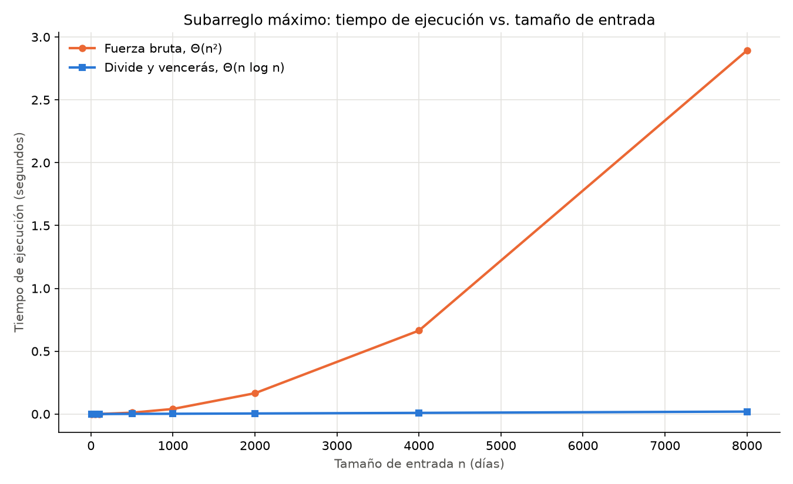
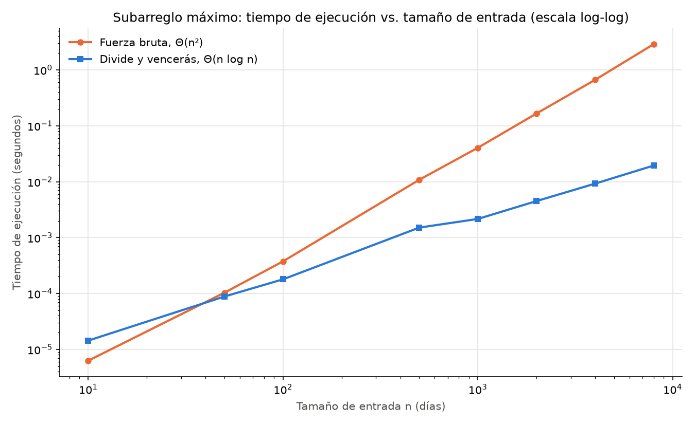

# Laboratorio 2 — Divide y vencerás: la mejor racha de cada tienda

**Autor:** Samuel Andrés García Sierra

## Cómo reproducir el experimento

Requisitos: Python 3.12 y `matplotlib` (no se usa entorno virtual; la librería se instala en el intérprete del sistema).

```bash
# 1. Instalar la única dependencia externa (solo para la gráfica)
python -m pip install matplotlib

# 2. Ubicarse en la carpeta del laboratorio
cd laboratorios/lab2-divide-y-vencer

# 3. Ejecutar las pruebas (imprime "Todas las pruebas pasaron.")
python pruebas.py

# 4. Ejecutar la medición (imprime la tabla de tiempos y regenera las gráficas)
python medicion.py
```

> Si prefiere aislar la dependencia, puede crear un entorno con `python -m venv .venv`, activarlo (`.venv\Scripts\activate` en Windows o `source .venv/bin/activate` en Linux/macOS) y repetir los pasos 1 a 4.

---

## Parte 1 — Implementación y verificación

Código: [subarreglo.py](subarreglo.py) · [pruebas.py](pruebas.py)

Se implementaron tres funciones:

- `subarreglo_fuerza_bruta`: fija el día inicial `i` y avanza el día final `j`, acumulando la suma sobre la marcha (no la recalcula para cada par), por lo que es Θ(n²).
- `suma_cruzada`: desde el punto medio recorre hacia la izquierda buscando el mejor sufijo y hacia la derecha buscando el mejor prefijo; el tramo cruzado es la unión de ambos.
- `subarreglo_maximo`: caso base de un elemento, dos llamadas recursivas sobre cada mitad, el caso cruzado y una comparación explícita con `if` para quedarse con el mejor de los tres.

Ninguna función modifica la lista: se trabaja siempre con índices, sin cortes (*slices*) ni reordenamientos.

**Cómo se verificó.** `pruebas.py` usa `assert` y compara siempre la **suma** (no los índices, porque puede haber empates). Una función auxiliar ejecuta ambos algoritmos sobre cada caso y comprueba además que la lista quedó idéntica a una copia tomada antes de la llamada. Casos cubiertos:

| Caso | Entrada | Suma esperada |
|---|---|---|
| Serie de la situación problema | `[-3, 5, -2, 8, -6, 3, 9, -4]` | 17 (días 2 a 7) |
| Un solo elemento | `[7]`, `[-7]`, `[0]` | el propio valor |
| Todos negativos | `[-8, -3, -6, -2, -5, -4]` | -2 |
| Todos positivos | `[4, 1, 7, 3, 2, 9]` | 26 (la serie completa) |
| Tramo que cruza el medio | `[-8, 1, 7, 6, 2, -9]` | 16; cada mitad por separado solo llega a 8 |
| 30 listas aleatorias | tamaño 1–60, valores en [-100, 100], semilla 2026 | ambas funciones coinciden |

En las listas aleatorias también se recalcula la suma a partir de los índices devueltos, para confirmar que el tramo reportado de verdad suma lo que dice.

---

## Parte 2 — Medición

Código: [medicion.py](medicion.py)



Como en escala lineal la curva de divide y vencerás queda pegada al eje, se generó también la misma gráfica en escala log-log, donde se aprecian los tamaños pequeños:



**Cómo se midió.**

- Tamaños: 10, 50, 100, 500, 1000, 2000, 4000 y 8000. Desde 1000 cada tamaño duplica al anterior, para poder comparar factores de crecimiento.
- Datos: enteros entre -100 y 100 generados con `random.Random(2026)`. En cada tamaño se genera **una** lista y se usa la misma para ambos algoritmos.
- Cronómetro: `time.perf_counter()` envuelve **solo** la llamada al algoritmo; la generación de datos queda por fuera.
- Repeticiones: cada medición se repite 5 veces y se reporta el **menor** tiempo, que es el menos contaminado por otros procesos del sistema operativo (en tamaños de 10 o 50 una sola corrida es casi puro ruido).
- Control: en cada tamaño un `assert` exige que ambos algoritmos devuelvan la misma suma.
- Equipo: Windows 11, Python 3.12.10. Los tiempos absolutos cambian de una máquina a otra y de una corrida a otra; la forma de las curvas no.

Resultados de la corrida usada en este informe:

| n | Fuerza bruta (s) | Divide y vencerás (s) | Fuerza bruta / DyV |
|---:|---:|---:|---:|
| 10 | 0,000006 | 0,000014 | 0,44 |
| 50 | 0,000103 | 0,000088 | 1,17 |
| 100 | 0,000376 | 0,000180 | 2,10 |
| 500 | 0,010814 | 0,001510 | 7,16 |
| 1000 | 0,040467 | 0,002160 | 18,74 |
| 2000 | 0,165810 | 0,004504 | 36,81 |
| 4000 | 0,664265 | 0,009248 | 71,83 |
| 8000 | 2,893211 | 0,019483 | 148,50 |

---

## Parte 3 — Análisis

### 1. Recurrencia

Para un tramo de tamaño n, `subarreglo_maximo` hace dos llamadas recursivas sobre mitades de tamaño n/2. Luego `suma_cruzada` recorre cada elemento del tramo una vez, Θ(n). Elegir el mejor de tres y el caso base son Θ(1). Entonces:

T(n) = 2T(n/2) + Θ(n)

Con el método maestro: a = 2, b = 2, f(n) = Θ(n). Comparo f(n) con n^(log_b a) = n^(log₂ 2) = n¹. Como f(n) = Θ(n¹), aplica el **caso 2** (f crece igual que n^(log_b a)), y la solución es T(n) = Θ(n log n).

La fuerza bruta es Θ(n²) porque para cada inicio i recorre todos los finales j ≥ i, y cada paso hace trabajo constante gracias a que la suma se acumula. El total de pasos es n + (n−1) + … + 1 = n(n+1)/2, que es Θ(n²). Si se recalculara la suma desde cero para cada par, sería Θ(n³).

### 2. Lo medido contra lo esperado

En la gráfica lineal, la fuerza bruta se empina cada vez más; divide y vencerás parece una recta pegada al eje. En la log-log ambas son rectas, pero la de fuerza bruta tiene casi el doble de pendiente.

Tomando n = 4000 → 8000:

- Fuerza bruta: 2,893 / 0,664 ≈ **×4,36**. Θ(n²) predice ×4. Coincide, con un pequeño exceso atribuible a la caché.
- Divide y vencerás: 0,01948 / 0,00925 ≈ **×2,11**. Θ(n log n) predice 2 · log(8000)/log(4000) ≈ ×2,17. Coincide.

Los pares 1000 → 2000 (×4,10 y ×2,09) y 2000 → 4000 (×4,01 y ×2,05) muestran lo mismo.

### 3. Tamaños pequeños

Sí hay un punto de cruce, entre n = 10 y n = 50. Con n = 10 la fuerza bruta es más rápida (tarda 0,44 veces lo que tarda divide y vencerás); con n = 50 ya pierde (1,17 veces); desde ahí la ventaja de divide y vencerás solo crece. En la gráfica log-log las curvas se cruzan alrededor de n ≈ 40.

La razón es que Θ(·) esconde constantes. Divide y vencerás, en Python, paga en cada nivel llamadas a funciones, creación de tuplas y dos barridos en `suma_cruzada`, y hace unas 2n llamadas recursivas en total. La fuerza bruta solo ejecuta un ciclo muy simple. Cuando n es pequeño, n² y n log n son números parecidos (100 frente a ≈33 para n = 10), así que pesa más el costo fijo de cada operación que la cantidad de operaciones.

### 4. ¿Cuándo conviene dividir?

Para hallar el máximo de un arreglo, dividirlo a la mitad no mejora nada. Cada mitad devuelve su máximo y combinar es una sola comparación, Θ(1):

T(n) = 2T(n/2) + Θ(1)

Con el método maestro, n^(log₂ 2) = n y f(n) = Θ(1) = O(n^(1−ε)), así que aplica el **caso 1** y T(n) = Θ(n). Es exactamente lo mismo que recorrer el arreglo una vez, pero con el costo extra de la recursión. No se puede bajar de Θ(n), porque cualquier algoritmo tiene que mirar todos los elementos.

En el subarreglo máximo dividir sí sirve porque la alternativa directa es Θ(n²). El caso cruzado se resuelve en Θ(n) sin revisar todos los pares que cruzan, y eso es lo que baja el total a Θ(n log n). Dividir conviene cuando combinar es mucho más barato que resolver el problema completo de forma directa.

### 5. Concepto para la gerente

**Recomendación: usar divide y vencerás** (`subarreglo_maximo`).

*Estimación* para 1.000.000 de registros, escalando desde la medición de n = 8000 según el crecimiento de cada algoritmo (no de forma lineal):

- Fuerza bruta, Θ(n²): 2,89 s × (1.000.000 / 8000)² = 2,89 × 15.625 ≈ **45.000 s, unas 12,5 horas** por serie.
- Divide y vencerás, Θ(n log n): 0,0195 s × (10⁶ · log₂ 10⁶) / (8000 · log₂ 8000) ≈ 0,0195 × 192 ≈ **3,7 s** por serie.

Son estimaciones: suponen la misma máquina y constantes estables. Con 2.000 días por tienda ambos terminan rápido, pero con las series de sensores la fuerza bruta deja de ser viable y divide y vencerás sigue tardando segundos. Si se necesitara más velocidad, el algoritmo de Kadane resuelve el problema en Θ(n).
