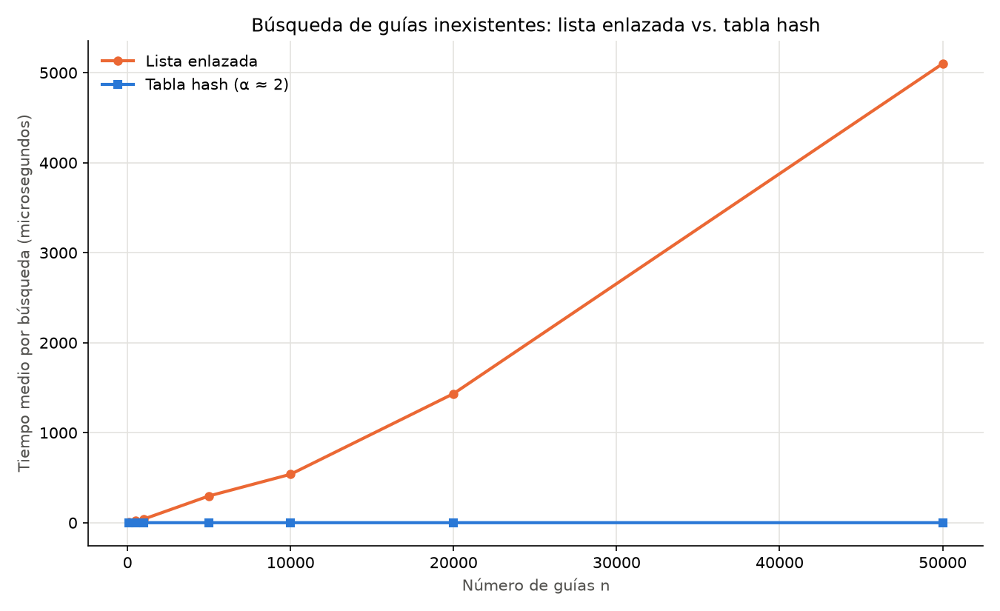
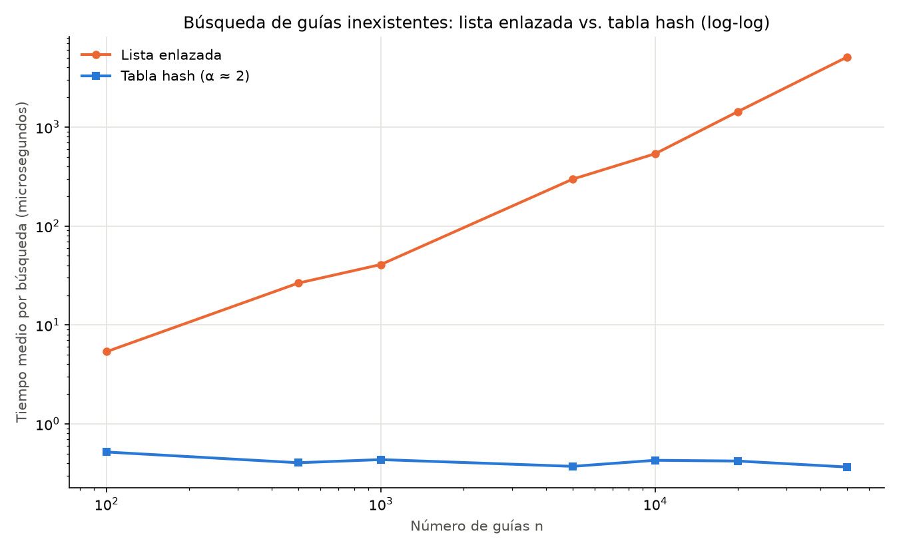
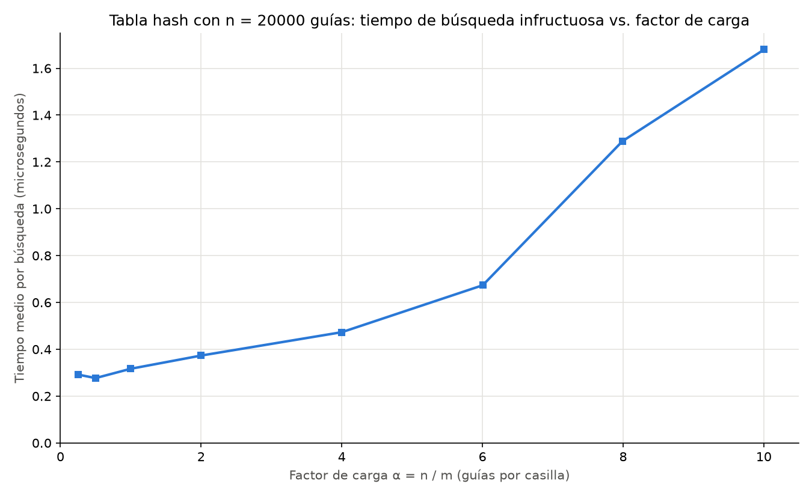

# Laboratorio 3 — Tabla hash: consulta de guías en Rutas del Caribe

**Autor:** Samuel Andrés García Sierra

## Cómo reproducir el experimento

Requisitos: Python 3.12 y `matplotlib`.

```bash
# 1. Instalar la única dependencia externa (solo para las gráficas)
python -m pip install matplotlib

# 2. Ubicarse en la carpeta del laboratorio
cd laboratorios/lab3-estructuras-datos

# 3. Ejecutar las pruebas (imprime "Todas las pruebas pasaron.")
python pruebas.py

# 4. Ejecutar la medición (imprime las tablas de tiempos y regenera las gráficas)
python medicion.py
```

---

## Parte 1 — Implementación y verificación

Código: [estructuras.py](estructuras.py) · [pruebas.py](pruebas.py)

- `ListaEnlazada.insertar` crea el nodo, lo enlaza con la cabeza actual y lo vuelve la nueva cabeza: Θ(1).
- `ListaEnlazada.buscar` recorre desde la cabeza con un `while` y devuelve `None` si llega al final.
- `TablaHash.hash` usa el método de la división, `k mod m`.
- `TablaHash.insertar` y `TablaHash.buscar` calculan la casilla y delegan en la `ListaEnlazada` de esa casilla (encadenamiento). No se usa `dict`, `set` ni `hash()`.
- `TablaHash.factor_carga` devuelve `tamano / m`.
- `TablaHash` rechaza con `ValueError` un número de casillas `m` menor que 1, en vez de fallar después con `ZeroDivisionError` o `IndexError`.

**Cómo se verificó.** `pruebas.py` usa `assert`:

| Caso | Qué se comprueba |
|---|---|
| Serie de la situación problema | búsqueda exitosa (`1000000024` → "en reparto") e infructuosa (`1000000099` → `None`) en lista y tabla |
| Estructuras vacías | toda búsqueda devuelve `None`; α = 0 |
| m inválido | `TablaHash(0)` y `TablaHash(-7)` lanzan `ValueError` |
| Inserción al inicio | la última guía insertada queda como cabeza |
| Colisión forzada, m = 7 | 10, 24 y 17 dan `hash == 3`; las tres se encuentran; la casilla 3 mide 3 (por `tamano` y contando nodos); las demás quedan vacías; la guía 3, que cae en la misma casilla, no existe |
| Factor de carga | `factor_carga() == 3 / 7` tras las tres inserciones |
| 30 colecciones aleatorias | n entre 1 y 500, m ∈ {1, 2, 7, 97, 101, 1009}, semilla 2026; para cada guía existente y para 50 inexistentes, lista y tabla devuelven lo mismo |

---

## Parte 2 — Medición

Código: [medicion.py](medicion.py)

**Cómo se midió.**

- Guías: enteros distintos de diez dígitos con `random.Random(2026 + n).sample(...)`. En cada n, la lista y la tabla se cargan con **las mismas** guías.
- Búsquedas: 200 guías inexistentes generadas con `generar_guias_inexistentes` (semilla 7).
- Tabla del experimento A: m primo más cercano a n / 2, para α ≈ 2. Experimento B: n = 20.000 y m primo más cercano a n / α.
- Control: antes de medir, para una muestra de 200 guías existentes se exige que lista, tabla y estado esperado coincidan, y que las 200 inexistentes devuelvan `None` en ambas.
- Cronómetro: `time.perf_counter()` envuelve **solo** el ciclo de búsquedas. Cada medición se repite 5 veces y se toma la menor.
- En la tabla, las 200 búsquedas se repiten 50 veces dentro de la ventana (`VUELTAS_TABLA`), porque 200 búsquedas de ~0,3 µs suman unos 60 µs, un tiempo comparable al ruido del reloj. El tiempo reportado sigue siendo por búsqueda.
- Equipo: Windows 11, Python 3.12. Los tiempos absolutos cambian entre corridas; la forma de las curvas no.

### Experimento A — Lista frente a tabla



En escala lineal la tabla queda pegada al eje; en log-log se ve que es plana:



| n | m | α | Lista (µs) | Tabla (µs) | Lista / tabla | Cadena más larga |
|---:|---:|---:|---:|---:|---:|---:|
| 100 | 47 | 2,13 | 5,37 | 0,519 | 10 | 5 |
| 500 | 251 | 1,99 | 26,49 | 0,404 | 66 | 7 |
| 1.000 | 499 | 2,00 | 40,79 | 0,435 | 94 | 6 |
| 5.000 | 2.503 | 2,00 | 297,50 | 0,372 | 800 | 8 |
| 10.000 | 4.999 | 2,00 | 538,14 | 0,428 | 1.257 | 8 |
| 20.000 | 10.007 | 2,00 | 1.434,17 | 0,421 | 3.410 | 10 |
| 50.000 | 24.989 | 2,00 | 5.100,15 | 0,366 | 13.931 | 9 |

### Experimento B — Efecto del factor de carga



| α objetivo | m | α real | Tabla (µs) | Cadena más larga |
|---:|---:|---:|---:|---:|
| 0,25 | 79.999 | 0,25 | 0,292 | 4 |
| 0,5 | 40.009 | 0,50 | 0,277 | 5 |
| 1 | 19.997 | 1,00 | 0,317 | 8 |
| 2 | 10.007 | 2,00 | 0,373 | 10 |
| 4 | 4.999 | 4,00 | 0,473 | 16 |
| 6 | 3.331 | 6,00 | 0,673 | 15 |
| 8 | 2.503 | 7,99 | 1,289 | 20 |
| 10 | 1.999 | 10,01 | 1,680 | 21 |

---

## Parte 3 — Análisis

### 1. Costo teórico

En una lista enlazada los elementos no están organizados para encontrar directamente una guía. Para saber que una guía no existe hay que recorrer los n nodos, y cada iteración del `while` cuesta tiempo constante: Θ(n).

La tabla hash usa `k mod m` para saber en qué posición debería estar la guía, en tiempo constante, y luego recorre la lista de esa posición. Si las guías se distribuyen de manera uniforme, cada lista tiene en promedio n / m = α elementos, así que una búsqueda fallida cuesta Θ(1 + α): el 1 es el hash y el acceso, α el recorrido.

El supuesto es el **hashing uniforme simple**: cada guía tiene la misma probabilidad de caer en cualquier posición, independientemente de las demás. Si todas cayeran en la misma posición, tendríamos una lista de n elementos y volveríamos a Θ(n). Esto puede pasar si las claves tienen patrones relacionados con m; un m primo ayuda a evitarlo, aunque no lo garantiza.

### 2. Lo medido contra lo esperado

De 5.000 a 10.000 guías:

- **Lista:** de 297,50 a 538,14 µs, ×1,81. Θ(n) predice ×2: es cercano.
- **Tabla:** de 0,372 a 0,428 µs, ×1,15. Es prácticamente constante; la diferencia es variación de la medición. De 100 a 50.000 guías se mantuvo entre 0,37 y 0,52 µs sin tendencia.

En los tamaños grandes la lista crece algo más que lineal: el costo por nodo pasa de 0,05 µs (100 guías) a 0,10 µs (50.000). Una posible explicación es la caché: con muchos nodos dispersos, llegar al siguiente tarda más. Cambia el tiempo real, no la complejidad.

En la segunda gráfica, con α entre 0,25 y 1 el tiempo se queda entre 0,28 y 0,32 µs, dominado por el hash y el acceso. Luego crece: 0,37 µs con α = 2, 0,47 con α = 4 y 1,68 con α = 10. Coincide con Θ(1 + α): un costo fijo más uno que depende de la cadena. El último tramo crece más que lineal, posiblemente por la caché.

### 3. Colisiones

Una colisión ocurre cuando claves diferentes generan la misma posición: con m = 7, las guías 10, 24 y 17 dan 3.

Pueden ocurrir aunque haya posiciones libres, porque nada impide que dos claves den el mismo resultado, y con muchos elementos coincidir es muy probable (paradoja del cumpleaños). En el experimento B, con 79.999 posiciones para 20.000 guías, la más ocupada tuvo cuatro.

**Encadenamiento:** cada posición guarda una lista enlazada y las guías que chocan se agregan a ella; la posición 3 queda `17 → 24 → 10`. Ventaja: es sencillo, admite α mayor que 1 y eliminar es retirar un nodo. Costo: memoria para los punteros y peor rendimiento con listas largas o nodos dispersos.

**Direccionamiento abierto:** los elementos se guardan en el propio arreglo; si una posición está ocupada se prueba otra. Con sondeo lineal: 10 va a 3, 24 a 4 y 17 a 5. Ventaja: no usa punteros y la memoria es contigua. Costo: exige α menor que 1, al llenarse aumentan las posiciones revisadas y se forman agrupaciones, y eliminar requiere un manejo especial.

### 4. Tabla hash o árbol de búsqueda

La tabla no sirve para el rango, porque `k mod m` no conserva el orden: números consecutivos quedan en posiciones distintas. Habría que recorrer los n elementos, Θ(n), o buscar cada número del rango: un rango de un millón de números con 50 guías serían un millón de búsquedas.

Un árbol binario de búsqueda mantiene los elementos ordenados: se localiza el límite inferior y se recorre en orden hasta superar el superior, evitando las ramas que no interesan. Cuesta O(h + k), con h la altura y k los elementos encontrados.

Si las 400.000 guías llegan ordenadas y se insertan sin balancear, cada una queda a la derecha de la anterior: el árbol se vuelve una lista de altura 399.999 y una búsqueda puede requerir unas 400.000 comparaciones. Un árbol balanceado (AVL o rojinegro) mantiene la altura en log₂(400.000) ≈ 19 comparaciones.

### 5. Recomendación para la jefa de operaciones

Recomiendo combinar una tabla hash, para la consulta puntual, con un árbol balanceado, para el rango, ambos apuntando a los mismos envíos. Cuesta memoria para los índices y actualizar las dos estructuras. La tabla debe redimensionarse con un m primo para mantener α cerca de 2.

**Estimación con 5.000.000 de envíos** (son proyecciones, no mediciones):

- **Lista:** la gráfica muestra crecimiento lineal, así que el tiempo es proporcional a n. Con 50.000 guías se tardaron 5.100 µs, unos 0,10 µs por nodo: 5.000.000 × 0,10 µs ≈ **0,5 s**, quizá más, porque el costo por nodo venía subiendo.
- **Tabla con α ≈ 2:** el tiempo no depende de n sino de α. Con α = 2 se midieron 0,37 µs, así que espero unos **0,4 µs**, menos de 1 µs.
- **Tabla sin redimensionar:** con 25.000 posiciones, α = 200 y una búsqueda recorrería unos 200 nodos, ≈ 20 µs. Mejor que la lista, pero ya no constante.
